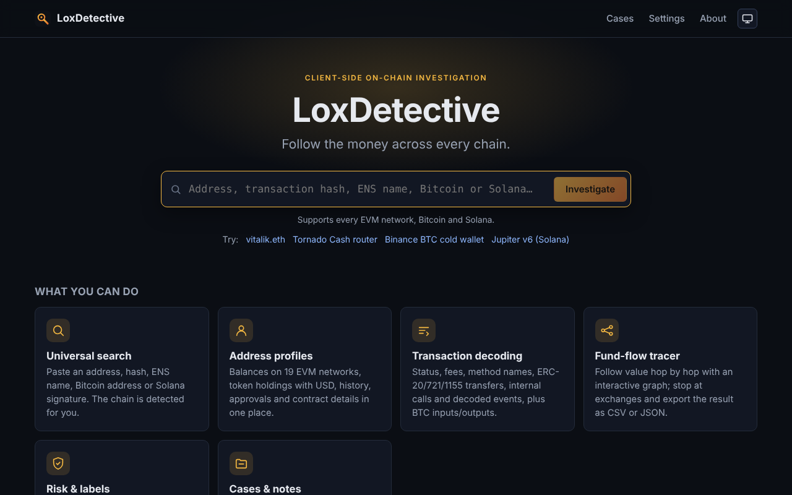
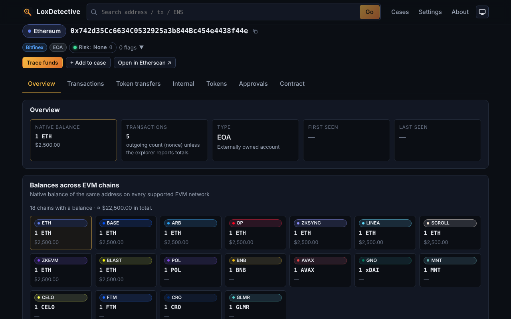
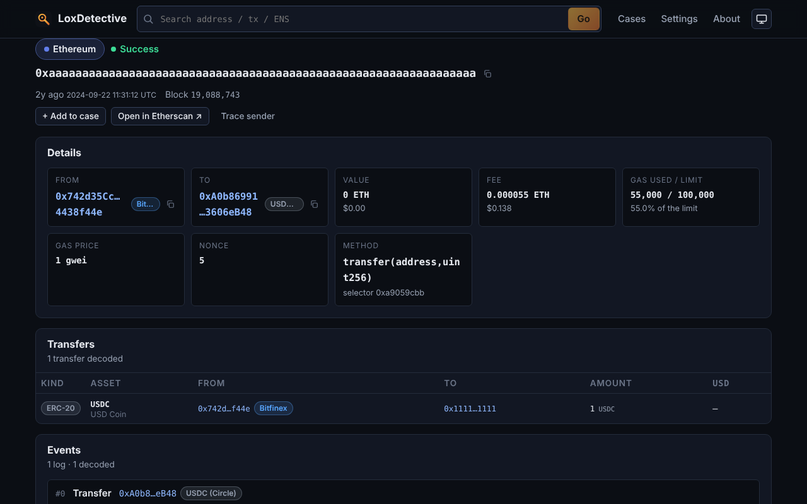
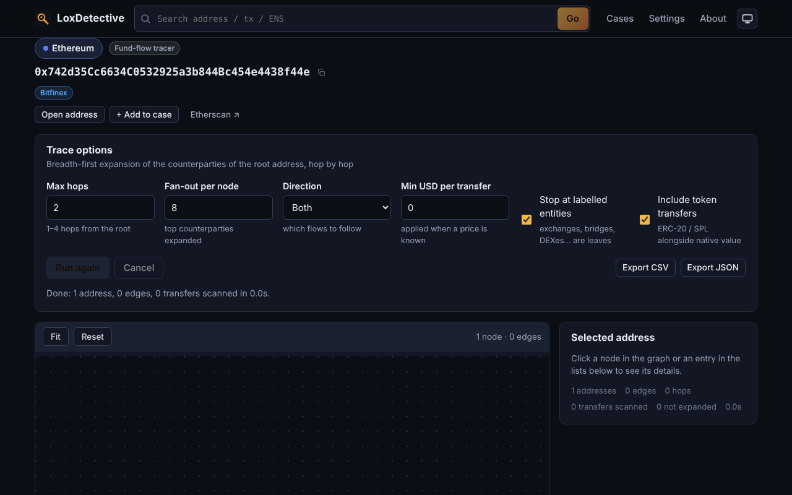
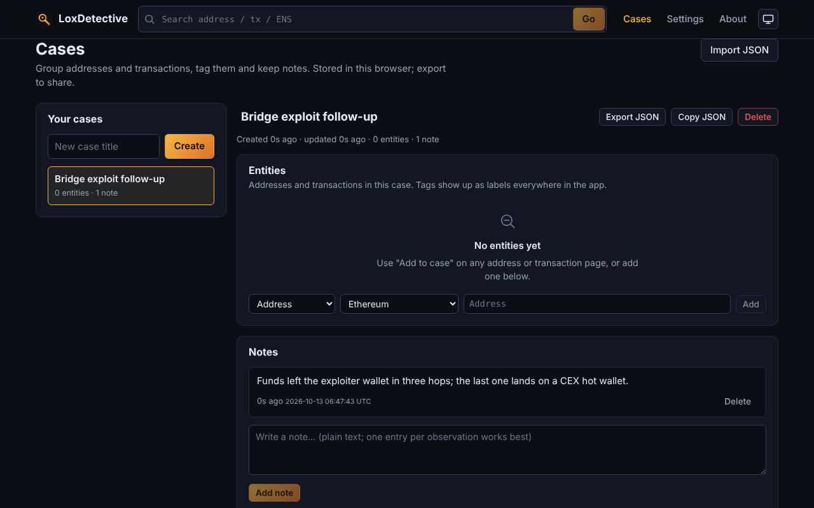
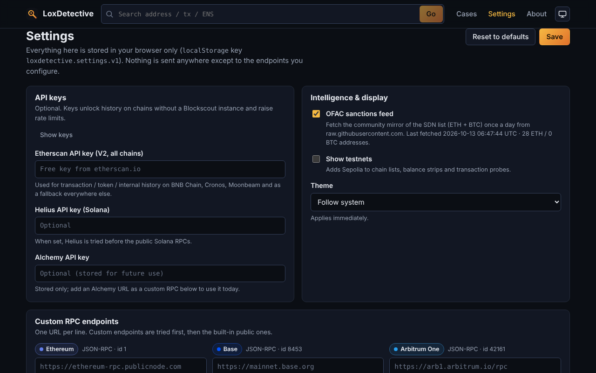

<p align="center">
  
</p>

<h1 align="center">LoxDetective</h1>

<p align="center">
  <strong>A client-only, multi-chain on-chain investigation toolkit.</strong><br />
  Follow the money across 19 EVM networks, Bitcoin and Solana — entirely in your browser, no backend, no sign-up.
</p>

<p align="center">
  <a href="https://loxlid.github.io/loxdetective/"></a>
  <a href="https://github.com/loxlid/loxdetective/actions/workflows/ci.yml"></a>
  <a href="https://github.com/loxlid/loxdetective/actions/workflows/deploy.yml"></a>
  <a href="LICENSE"></a>
  
  
</p>

<p align="center">
  <a href="#live-demo">Live demo</a> ·
  <a href="#features">Features</a> ·
  <a href="#quick-start">Quick start</a> ·
  <a href="#configuration--api-keys">Configuration</a> ·
  <a href="#deploying-to-github-pages">Deploy</a> ·
  <a href="#data-sources">Data sources</a> ·
  <a href="#privacy">Privacy</a> ·
  <a href="#limitations--disclaimer">Disclaimer</a>
</p>

---

## Live demo

**https://loxlid.github.io/loxdetective/**

Paste an address, transaction hash or ENS name into the search bar and go. Nothing you type leaves your browser except the public blockchain queries needed to answer it.

## Why LoxDetective?

Block explorers show you *a* transaction. Investigations need the *story*: where did the funds come from, where did they go, who are the counterparties, and is any of this touching a mixer, a sanctioned entity or a known scam? Commercial forensics suites answer those questions behind a paywall and a login; LoxDetective answers the common ones for free, on-chain, with code you can read.

- **Client-only.** A static site on GitHub Pages. There is no server to trust, log you, or go down.
- **Multi-chain by default.** One search checks every supported network and tells you where the entity lives.
- **Investigator-oriented.** Fund-flow graphs, risk heuristics, labels, approval audits and case files instead of raw explorer tables.
- **Bring your own endpoints.** Works out of the box on public RPCs; add your own RPCs and API keys when you need more throughput or history.

## Features

### Universal search
- Paste anything: an `0x` address, a transaction hash, an ENS name, a Bitcoin address/txid, a Solana account/signature or a block number.
- Input is classified locally (`detectInput`), ambiguous inputs are probed in parallel and you are taken straight to the right page on the right chain.
- Transaction hashes are located automatically across all EVM networks (`findTxChain`).

### Multi-chain address profile
- One profile per address on **19 EVM networks + Bitcoin + Solana**, with a multi-chain native balance strip for EVM addresses.
- Overview cards: balance (with USD), nonce / transaction count, contract vs. EOA, ENS reverse name, first/last activity, labels and a **risk badge**.
- Tabs for **Transactions**, **Token Transfers**, **Tokens** (with USD values), **Internal** calls, **Approvals** and **Contract**.
- Contract tab: verification status, proxy detection (EIP-1967, EIP-1822/UUPS, EIP-1167 minimal proxies, beacons), implementation address, creator, creation tx and a link to verified source.
- Quick actions: *Trace funds*, *Add to case*, *Open in explorer*, copy.

### Transaction decoding
- Status, block, timestamp, from/to with labels, value, fee, gas, nonce, type and raw input.
- Method name from a built-in selector table, Blockscout, or the public signature databases (openchain.xyz, 4byte.directory).
- Decoded **ERC-20 / ERC-721 / ERC-1155** transfers (with USD), internal calls, decoded events (Transfer, Approval, Swap, Deposit/Withdrawal, OwnershipTransferred, Upgraded, …) and a raw-logs toggle.
- Bitcoin: inputs, outputs, fee, size/weight and confirmations. Solana: SOL and SPL balance changes, program names and log messages.

### Fund-flow tracer with graph
- Breadth-first tracing of inbound, outbound or both directions for 1–4 hops with configurable fan-out, minimum USD filter and token inclusion.
- Stops at labelled entities (exchanges, bridges, DEXes…) so the graph ends where the money leaves the chain.
- Interactive **D3 force-directed graph**: node colours by label/risk, edge width by value, zoom/pan/drag, hover tooltips, click-to-inspect side panel, "fit" and legend.
- Summary of top sinks, top sources and labelled endpoints; **export to CSV or JSON**.

### Risk heuristics & labels
- Deterministic, explainable risk score (0–100) with flags such as *sanctioned*, *mixer (direct / 1-hop)*, *fresh wallet*, *high velocity*, *dust pattern*, *pass-through*, *unlimited approvals*, *unverified contract*, *scam label*, *exchange deposit* and *large value*. Each flag carries evidence you can click through.
- Built-in label set (exchanges, bridges, DEX routers, lending, mixers, stablecoins, burn addresses, infrastructure) for EVM, Bitcoin and Solana.
- **OFAC sanctions**: a built-in snapshot plus an optional daily-refreshed feed from the community mirror of the SDN list (ETH and BTC addresses).
- Your own case tags become labels everywhere in the UI.

### Approvals audit
- Lists live ERC-20 / ERC-721 / ERC-1155 allowances granted by an address, highlights **unlimited** approvals and unlabelled spenders, and links to the granting transaction.

### Cases & notes
- Create investigation cases, add addresses and transactions as entities with tags and colours, keep free-text notes.
- Everything is stored locally; **export / import** cases as JSON to share with colleagues.

### Exports
- Fund-flow graphs as CSV or JSON, cases as JSON, and one-click explorer links for everything else.

## Screenshots

> Captured from the production build against the mocked network the e2e suite uses
> (`npm run build && SCREENSHOTS=1 npx playwright test e2e/screenshots.spec.ts`), so they
> show fixture data (1 ETH, one USDC transfer, empty history) rather than a live chain.

| Home & universal search | Address profile |
| --- | --- |
|  |  |

| Transaction decoding | Fund-flow tracer |
| --- | --- |
|  |  |

| Cases & notes | Settings |
| --- | --- |
|  |  |

## Supported networks

| Family | Networks |
| --- | --- |
| EVM mainnets (18) | Ethereum, Base, Arbitrum One, OP Mainnet, Polygon PoS, BNB Smart Chain, Avalanche C-Chain, Gnosis Chain, zkSync Era, Linea, Scroll, Polygon zkEVM, Blast, Mantle, Celo, Fantom Opera, Cronos, Moonbeam |
| EVM testnets (1) | Sepolia (hidden unless *Show testnets* is enabled in Settings) |
| Bitcoin | Mainnet via Esplora-compatible APIs (mempool.space, Blockstream) |
| Solana | Mainnet-beta via public JSON-RPC (optionally Helius) |

The registry lives in [`src/lib/chains/registry.ts`](src/lib/chains/registry.ts); adding an EVM chain is a single entry.

## Quick start

Requirements: **Node.js 22** and **npm** (the lockfile is npm's).

```bash
git clone https://github.com/loxlid/loxdetective.git
cd loxdetective
npm ci
npm run dev          # http://localhost:5173/loxdetective/
```

Other scripts:

| Command | What it does |
| --- | --- |
| `npm run build` | Typecheck + production build into `dist/` |
| `npm run preview` | Serve `dist/` locally (used by the e2e tests) |
| `npm run typecheck` | `tsc --noEmit` in strict mode |
| `npm test` | Vitest unit tests (all network calls are mocked) |
| `npm run e2e` | Playwright smoke tests against the built app (`npm run build` first) |
| `SCREENSHOTS=1 npx playwright test e2e/screenshots.spec.ts` | Regenerate the README screenshots in `docs/screenshots/` from the mocked build |
| `npm run check` | typecheck + unit tests + build |

The app is served under `/loxdetective/` to match GitHub Pages. Set `VITE_BASE=/` (or your own path) to build for a different location:

```bash
VITE_BASE=/ npm run build
```

## Configuration & API keys

LoxDetective works without any configuration on public endpoints. Everything below is optional and lives in **Settings** (`/#/settings`), stored in your browser's `localStorage` under `loxdetective.settings.v1`.

| Setting | Effect |
| --- | --- |
| **Custom RPC URLs** (per chain, one per line) | Prepended to the built-in list; your endpoints are tried first. Use this for a private node, a paid provider or when a public RPC rate-limits you. |
| **Etherscan API key** | Enables transaction / token-transfer / internal-call history on chains without a Blockscout instance (BNB Smart Chain, Cronos, Moonbeam) through the Etherscan V2 multi-chain API, and acts as a fallback everywhere else. A free key is enough. |
| **Alchemy API key** | Stored for upcoming premium history providers; not used for requests yet. |
| **Helius API key** | When set, `https://mainnet.helius-rpc.com` becomes the preferred Solana RPC. |
| **Show testnets** | Adds Sepolia to the chain lists. |
| **OFAC sanctions feed** | Fetch the community SDN mirror at runtime (cached for 24 h). Disable to rely on the built-in snapshot only. |
| **Theme** | System / dark / light. |
| **Reset** | Restores the defaults. |

Keys are only ever sent to the provider they belong to, as part of that provider's request URL or JSON-RPC endpoint, straight from your browser.

## Deploying to GitHub Pages

The repository ships with a ready-made workflow ([`.github/workflows/deploy.yml`](.github/workflows/deploy.yml)). To publish your own fork:

1. **Fork or push** the repository to GitHub, e.g. `https://github.com/<you>/loxdetective`.
2. In the repository open **Settings → Pages**.
3. Under **Build and deployment → Source** choose **GitHub Actions** (not "Deploy from a branch").
4. **Push to `main`** (or run *Deploy to GitHub Pages* from the **Actions** tab via *Run workflow*). The workflow installs dependencies, typechecks, runs the unit tests, builds and deploys `dist/`.
5. After the first run the site is live at `https://<you>.github.io/loxdetective/`. The URL is also shown on the workflow's deployment summary.

Notes:

- If your repository is **not** called `loxdetective`, change `VITE_BASE` in both workflows (`deploy.yml`, `ci.yml`) and the `/loxdetective/` default in `vite.config.ts`, `playwright.config.ts` and `public/404.html` to `/<repo-name>/`.
- For a **custom domain** or a user site (`<you>.github.io`), set `VITE_BASE=/`.
- The app uses hash routing (`/#/address/…`), so no server-side rewrites are needed; `public/404.html` forwards accidental deep links to the right hash route.
- Pull requests and feature branches run [`ci.yml`](.github/workflows/ci.yml): typecheck, unit tests, build and the Playwright smoke suite.

## Data sources

Every request is made directly from the browser to a public, CORS-enabled API. The full list with rate limits and CORS notes is in [`docs/DATA_SOURCES.md`](docs/DATA_SOURCES.md).

| Data | Source | Key? |
| --- | --- | --- |
| EVM balances, code, nonces, transactions, receipts, blocks, logs, `eth_call` | Public JSON-RPC endpoints per chain (PublicNode, LlamaRPC, Cloudflare, Ankr, 1RPC, chain-operated RPCs…) with ordered fallback; your own RPCs first | No |
| EVM history, token balances, internal calls, verified contracts | Blockscout API v2 instances (Ethereum, Base, Arbitrum, Optimism, Polygon, Gnosis, zkSync, Linea, Scroll, Polygon zkEVM, Blast, Mantle, Celo, Sepolia) | No |
| EVM history fallback / chains without Blockscout | Etherscan V2 multi-chain API; Routescan (keyless) for Avalanche and Fantom | Etherscan: yes (free) |
| Bitcoin addresses, transactions, UTXOs | Esplora REST API — mempool.space, Blockstream | No |
| Solana accounts, token accounts, signatures, transactions | Solana JSON-RPC — api.mainnet-beta.solana.com, PublicNode, dRPC (Helius with a key) | Optional |
| USD prices | DefiLlama coins API | No |
| Function selectors | openchain.xyz, 4byte.directory (after a built-in table) | No |
| ENS forward / reverse resolution | On-chain via `eth_call` on Ethereum | No |
| Sanctions | Built-in OFAC snapshot + community mirror of the OFAC SDN digital-currency address list | No |
| Labels | Built-in curated list shipped with the app | — |

## Privacy

- **No backend, no analytics, no cookies.** The site is static files on GitHub Pages.
- **Your queries go straight to the data providers** listed above. Those providers can see your IP address and the addresses you look up, just as they would from any block explorer. Use your own RPC endpoints if that matters to you.
- **API keys, custom RPCs, cases, notes, recent searches and the sanctions cache stay in your browser's `localStorage`.** They are never transmitted anywhere except, for keys, to the provider they are for. Clearing site data removes everything.
- Case exports are plain JSON files that you download and share yourself.

## Limitations & disclaimer

- **Not financial, legal or investment advice.** LoxDetective is an analysis tool. Nothing it shows is a recommendation, and nothing it shows should be used as the sole basis for a decision.
- **Labels and risk flags are best-effort heuristics**, not findings of fact. An address labelled "exchange" may be wrong or outdated, a "high" risk score can be a false positive, and a "none" score is not proof of anything. Always verify against primary sources before acting on a result or naming anyone.
- **Sanctions data** comes from a built-in snapshot and a community-maintained mirror of the OFAC list. It may lag the official SDN list; the authoritative source is [OFAC](https://ofac.treasury.gov/).
- **Public endpoints have limits.** Free RPCs and explorer APIs rate-limit, drop old history, or go down. The app degrades gracefully (fallback endpoints, partial data, clear error messages), but completeness depends on the providers. Add your own RPCs and an Etherscan key for best results.
- **History depth varies by chain.** Chains without a Blockscout instance need an Etherscan key for transaction lists; approvals are scanned over a bounded block range; Solana history is signature-based and enriched lazily.
- **Tracing is bounded** by hop count and fan-out; a graph is a sample of activity, not the full ledger.
- Off-chain (CCIP-read) ENS names and some exotic token contracts are not resolved.

## Roadmap

- [ ] Alchemy / premium history providers behind the stored key
- [ ] Deeper Bitcoin and Solana tracing (UTXO clustering heuristics, SPL hop tracing)
- [ ] Share a case as a URL-encoded, read-only snapshot
- [ ] Timeline view of an address's activity
- [ ] More label sources (community label lists, user-importable CSV)
- [ ] Watchlist with local notifications when an address moves funds
- [ ] i18n of the UI
- [ ] Progressive Web App (offline shell, installable)

Have an idea? Open an issue or a discussion on GitHub.

## Contributing

Contributions are welcome — bug reports, label corrections, new chains, new heuristics and documentation alike. Please read [`CONTRIBUTING.md`](CONTRIBUTING.md) for the development workflow, code conventions and how to add a chain or a label. By participating you agree to keep discussions respectful and on topic.

## License

Released under the [MIT License](LICENSE). Copyright (c) 2026 loxlid.

Block explorer, RPC and data-provider names are trademarks of their respective owners; LoxDetective is not affiliated with any of them.
